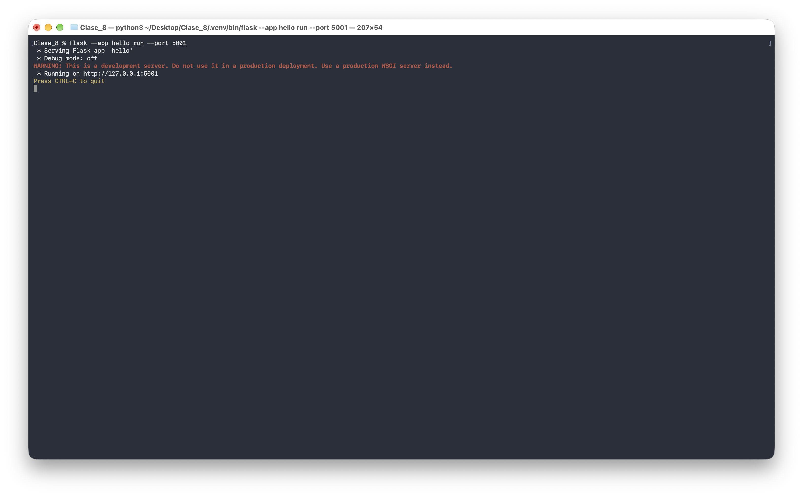
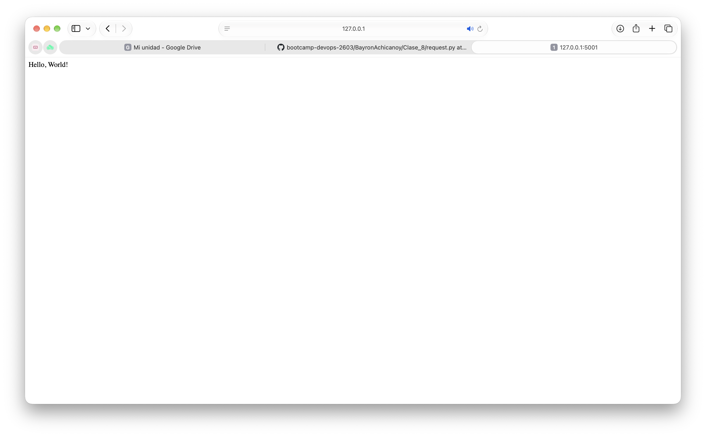
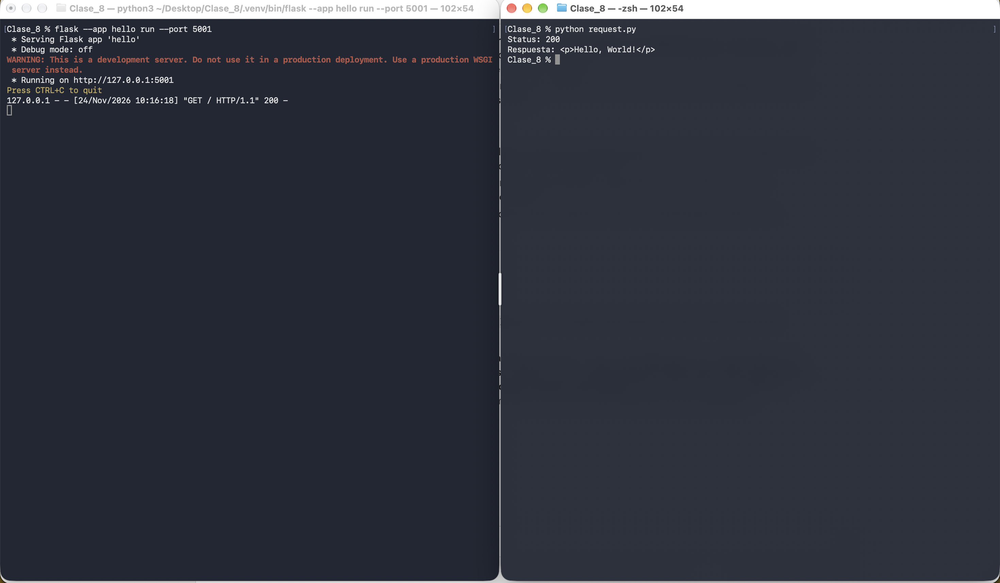

# Clase 8 - Aplicación Flask + request desde Python

## Preparar entorno
```bash
python3 -m venv .venv
source .venv/bin/activate
pip install Flask requests
```

## Ejecutar la app
```bash
flask --app hello run
```

## Hacer el request (en otra terminal, con el entorno activado)
```bash
python request.py
```

## Evidencias

### Servidor Flask corriendo


### Respuesta en el navegador


### Request desde Python

