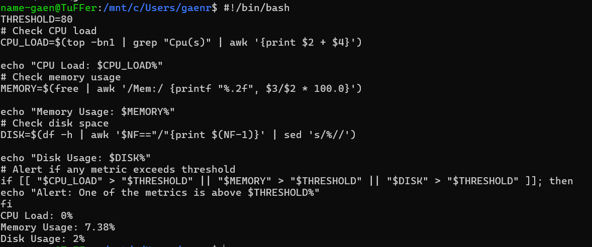

# Tarea 4: Scripts de Bash

**Autor:** Gabriel Ramírez

## Punto 1: Monitoreo de recursos (`monitoreo.sh`)

Script basado en el gist:
https://gist.github.com/jthan24/de226afb3f84439ff122684ad047e469

Muestra el uso de CPU, memoria y disco, y avisa si alguno supera el 80 %.

**Ejecutado en WSL.** La salida es la siguiente:



```bash
chmod +x monitoreo.sh
./monitoreo.sh
```

## Punto 2: Variable impresa (`imprimir.sh`)

Script que pide un valor por teclado, lo guarda en `MI_VARIABLE` y lo imprime al ejecutarse.

Solo se creó el archivo `imprimir.sh`. No se ejecutó como parte de esta entrega.

```bash
chmod +x imprimir.sh
./imprimir.sh
```
